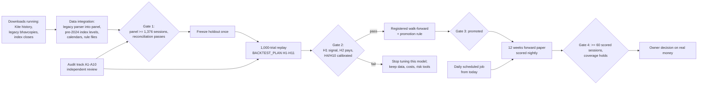

# Roadmap from here: the critical path, the gates, and who does each job

As of 7 Nov 2026 (branch `main`). One page so any worker — the owner, a strong model, a lower-cost model
or a plain script — can pick up a job without re-deriving the plan. Each job has a pass/fail check; a job is done
when its check passes, not when its code exists.

## Where things stand

| Area | State |
|---|---|
| Daily data (NSE official files, from Jul 2024) | Working; 583 sessions in the panel |
| Model and ranking | Corrected (errata E19–E23) and independently audited: 1,804 forecasts, zero arithmetic mismatches; first out-of-sample window shows skill (IC +0.13) over only 4 independent periods: **unvalidated** |
| Dashboard, capital switch, explanations, Gemini/Claude explainer | Working, live-checked on real data |
| Kite history (every NSE equity + 20 indices, back to 2000) | Downloading now (resumable); provider-adjusted, survivor-only: a price filler, not the universe |
| Legacy NSE bhavcopies 2016 → Jul 2024 | Downloading now (official archive, one request per file); not yet readable by the panel |
| Forward evidence | One forward-eligible ranking per evening, **only if the daily job runs** |

## The critical path

Nothing to the right of a gate starts before the gate passes. The daily job (bottom) runs in parallel from today,
because forward evidence cannot be made up later.

## Timeline

| When | Phase | Exit check |
|---|---|---|
| Now (running) | Downloads: Kite history, legacy bhavcopies 2016–2024, then index closes 2016–2024 | Summaries say COMPLETE; refusals recorded, not retried |
| Week 1 | Data integration | `panel-build` reports ≥ 1,376 sessions with no gap in any lookback; `actions-reconcile` over 2016–2026 keeps every listed split/bonus ratio-consistent |
| Week 1–2 | Holdout frozen; trial runner built; 1,000 trials run overnight | `trials-score` writes the H1–H11 table with CIs |
| Week 2 | Read the result (owner + strong model) | Gate 2 decided in writing |
| Week 2–3 | Registered walk-forward + promotion (only if Gate 2 passes) | A promotion record, or a written "no" |
| From today, 12 weeks | Forward record (needs the daily job) | ≥ 60 scored sessions |
| In parallel, any time | Product work (young stocks, SME, projections, funds) | Each item's own test |

## Who does each job: the models

| Worker | Entrust it with | Never with |
|---|---|---|
| **Claude Fable 5 / Claude Opus 5.5** (strong) | Anything that can silently bias results: labels, features, gates, point-in-time rules, the trial runner's core, evaluation and promotion, interpreting evidence, applying audit fixes, reviewing cheaper models' changes to `src/marketlab/quant/` | Grading its own designs (use an independent reviewer) |
| **GPT** (independent reviewer, another vendor) | Second opinions: the review that withdrew BALAMINES, re-verifying fixes, judging BACKTEST_PLAN, finishing the audit report it started | Changing the model code directly (it proposes; a strong model applies with a test) |
| **Claude Sonnet 5.5** (implementer) | Fully specified code with a pass/fail test: parsers, loaders, downloaders, CLI, UI, docs; web research with citations | Choices about what the model may know when |
| **Claude Haiku 5.5 / Gemini 3.8 Flash** (cheap, mechanical) | Reading saved raw files into tables, extracting names from notes, reconciling config text, routine summaries. Gemini's free tier sends what you give it to Google: public data only | Code under `src/marketlab/quant/` |
| **Script** | Downloads, nightly update, the 1,000 trials once written | Anything needing judgment |
| **Owner** | Kite logins, the scheduled task, keys, Gate 2 and the real-money decision | |

| # | Job | Who (model) | Why that worker | Pass/fail check |
|---|---|---|---|---|
| 1 | Keep the downloads going; resume after interruptions (`kite-download`, `scripts/legacy_acquire.py`) | Script (owner starts it) | Idempotent, resumable, counts only | Summaries COMPLETE |
| 2 | Register the daily job (`scripts/daily_update.cmd`) | **Owner** (the permission system blocks a model from adding a scheduled task) | A standing change to the machine | `schtasks /Query` shows it; `runs/daily_update/<day>.json` COMPLETE each evening |
| 3 | Kite login before any Kite job | **Owner** | Never automated (standing rule) | Session file valid |
| 4 | Legacy bhavcopy parser → panel rows (same columns as UDiFF; series, ISIN, OHLC, value) | Sonnet 5.5 | Column mapping against fixtures; fully testable | Transition days (3–5 Jul 2024, both formats stored) agree to the paisa |
| 5 | Pre-2024 index levels into the panel from `nse_indices_close` (Kite index candles only as cross-check) | Sonnet 5.5 | Same pattern as job 4 | Nifty 50 levels match Kite's within 0.05% on overlapping days |
| 6 | Holiday calendars 2016–2024 from NSE circulars (`calendar_sources.json`) | Haiku 5.5 or Gemini Flash extracts; **Opus 5.5 reviews** | Reading PDFs into dates is mechanical; a wrong holiday corrupts every label | Every stored bhavcopy date is a session; every weekday without one is a listed holiday |
| 7 | Kite candles as a price filler, survivorship-safe (bhavcopy defines the universe; count of bhavcopy-only ISINs recorded) | **Opus 5.5 / Fable 5** | Mixing adjusted provider prices with traded prices is a classic silent error | Reconciliation report; no Kite price used where a bhavcopy exists |
| 8 | Corporate-action reconciliation over 2016–2026; dividend bases (H-CA1) | **Opus 5.5 / Fable 5** | Decides which price jumps are real | `actions-reconcile`: every listed split/bonus ratio-consistent; H-CA1 answered in DATA_READINESS.md |
| 9 | Rule-file archives (surveillance REG1_IND, sec_list) for old years | Sonnet 5.5 | Downloads + loader mirror existing ones | Historical folds no longer `PANEL_ONLY` |
| 10 | Trial runner `marketlab trials` + `trials-score` (BACKTEST_PLAN §5) | **Fable 5 / Opus 5.5** builds the point-in-time core and its lookahead assertions; Sonnet 5.5 the CLI, files and tables; GPT reviews | The core is where lookahead hides | A planted-lookahead test trial is refused; seeds reproduce |
| 11 | Run the 1,000 trials | Script (overnight) | No judgment | `summary.json` complete |
| 12 | Interpret the trials; Gate 2 | **Fable 5 + GPT independently, then the owner** | Judgment; registered hypotheses only | Written decision per H1–H11 |
| 13 | Registered walk-forward + promotion (`evaluate`, then `--holdout` once) | **Opus 5.5 / Fable 5** | One-shot holdout | Promotion record or a written "no" |
| 14 | Newly listed stock model (docs/NEXT_MODELS.md §1) | **Opus 5.5 / Fable 5** | New features and conformal groups | Cohort B4 coverage 7–13% |
| 15 | SME shares with lot sizes (NEXT_MODELS §5) | Sonnet 5.5 after job 14 | Reuses 14's machinery | Lot affordability shown; Mondrian group calibrated |
| 16 | Mutual funds / ETFs from AMFI NAVs (NEXT_MODELS §3–4) | Sonnet 5.5 | Read official data, compute returns, costs, drawdowns | Matches AMFI's published returns for 5 schemes |
| 17 | IPO calendar display (NEXT_MODELS §2) | Haiku 5.5 | Display only | Matches NSE's issue pages |
| 18 | Projections tab (build spec: bootstrap wealth paths, index beside the strategy) | Sonnet 5.5; Opus 5.5 reviews the maths | Uses existing bootstrap | Reproducible from a seed; index option always shown |
| 19 | "If I hold it" view (sell-side threshold; EXIT.v1 on the card) | **Opus 5.5 / Fable 5** | Exit logic is a decision rule | Agrees with the paper ledger's exit on replayed lots |
| 20 | Contract-note reconciliation | Owner provides a note; Haiku 5.5 compares | Needs a real document | Charges match to the rupee |
| 21 | UI polish, docs, glossary | Sonnet 5.5 or Haiku 5.5 | Low risk; Node DOM check guards it | `tests/test_dashboard_render.py` passes |

## The audit track (parallel; docs/audit/AUDIT_BRIEF.md)

Jobs A1–A10 in the brief run alongside the critical path and feed it: A5 (second parser) and A8 (re-verify the bias
fixes) must finish before Gate 1; A6 (independent verdict on BACKTEST_PLAN) before the trial runner is built; A4
(BSE) is product scope, not on the critical path.

## Rules every worker keeps

Read CLAUDE.md first. Read-only broker access, no order code, no secrets in logs or commits, official exchange
hosts only with one request per file per day, `data/research/` never committed, the sealed holdout untouched, no
LLM in any decision path, and no loosening of gates or thresholds to produce buy candidates. A lower-cost model
that changes a file under `src/marketlab/quant/` must have the change reviewed by a strong model before merge.
